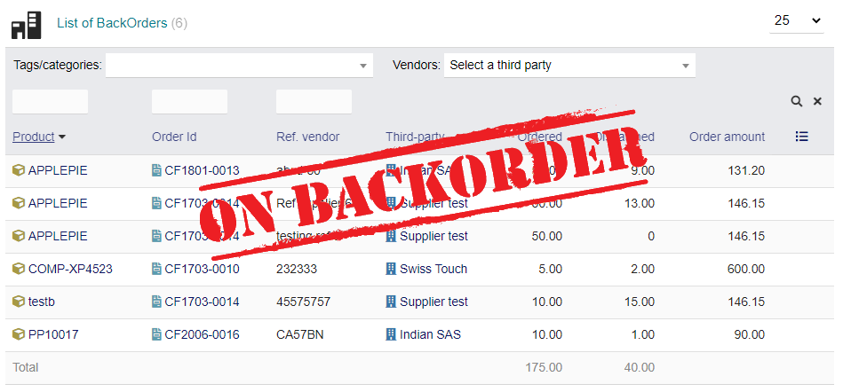

# RELIQUAT POUR <a href="https://www.dolibarr.org">DOLIBARR ERP CRM</a>



## Module Reliquat

### Le module Reliquat vous permet de gérer:

* Les reliquats de commande client en se basant sur les commandes clients ouvertes et les livraisons faites. Une livraison partielle de votre commande client fera ressortir un reliquat de livraison dans le module des reliquats. 
Il vous sera possible d'imprimer un pdf de reliquat depuis la commande concernée.
Si vous cloturez la commande en "classer/livrer" le reliquat disparaitra de l'affichage.
* Les reliquats de commande fournisseur en se basant sur les commandes fournisseurs ouverte et les livraisons recues. Une livraison partielle de votre commande fournisseur fera ressortir un reliquat de livraison dans le module des reliquats.
Si vous classer la commande en "Complète" au "Annulé" le reliquat disparaitra de l'affichage.

L'affichage des reliquats se situe dans " commerce/commande client/reliquat " et " commerce/commande fournisseur/reliquat ". Il sera possible de filtrer les reliquats par catégories de produits, par fournisseur, par commande, par ref produit et vous aurez un total des reliquats en volume de CA en bas de votre affichage.
Un aperçu de vos commandes en attente est également disponible dans le tableau de bord des commandes et commandes fournisseurs.

---

## Version

* Reliquat 1.0 
* Need Dolibarr 7.0 mini

---

## Installation

### Depuis le fichier Zip et l'interface de dolibarr

- Si vous avez acheter le module sur [Dolistore](https://www.dolistore.com)), aller directement au menu suivant
```Acceuil - Configuration - Modules - Deployer Installer un module externe``` et charger le fichier Zip.


Note: Si cet écran vous indique qu'il n'y a pas de répertoire personnalisé, vérifiez que votre configuration est correcte: 

- Dans votre installation Dolibarr, aller dans ```htdocs/conf/conf.php``` et vérifier que les lignes suivantes ne sont pas commentées:

    ```php
    //$dolibarr_main_url_root_alt ...
    //$dolibarr_main_document_root_alt ...
    ```

- Décommentez-les si nécessaire (supprimez le ```//```) et y mettre la bonne valeur en fonction de votre installation Dolibarr

    Par exemple :

    - UNIX:
        ```php
        $dolibarr_main_url_root_alt = '/custom';
        $dolibarr_main_document_root_alt = '/var/www/Dolibarr/htdocs/custom';
        ```

    - Windows:
        ```php
        $dolibarr_main_url_root_alt = '/custom';
        $dolibarr_main_document_root_alt = 'C:/My Web Sites/Dolibarr/htdocs/custom';
        ```
        
---

## Configuration

Depuis votre navigateur web:

  - Connecter vous en super-administrateur
  - Aller dans "Configuration" -> "Modules"
  - Chercher le module et le mettre sur ON
  - Cliquer sur la configuration du module
  - Activer ou non la gestion des reliquats clients et fournisseurs
  - Générer les reliquats

---

## Suppression

Mettre le module sur OFF et supprimer le dossier si nécessaire dans ```htdocs/custom```

---

## Veuillez également consulter notre autre modules:

- [Mobilid](https://www.dolistore.com/fr/modules/407-Connector-for-Mobilid-Mobile-app.html) Dolibarr dans votre entrepôt avec lecteur code-barres
- [Bloc Encours](https://www.dolistore.com/fr/modules/1282-Bloc-Encours.html) Bloquez les propals, commandes et factures si le montant du paiement en souffrance dépasse la limite fixée.

---

Licenses
--------

### Main code


GPLv3 et (at your option) toute version antérieure.

Voir le fichier COPYING pour plus d'information.

#### Documentation

Readme


